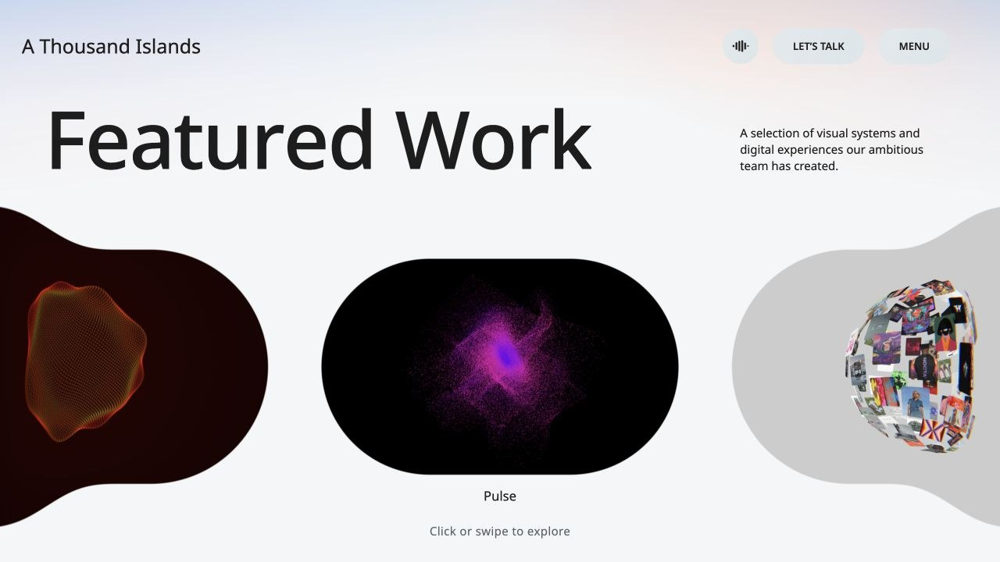

# A Thousand Islands

I’m Joel Meshak, a creative technologist based in Nairobi. A Thousand Islands is my independent studio for interactive websites and browser-based creative tools.

[Visit the studio](https://athousandislands.tech/) · [Open my portfolio](https://joelmeshak.com/)

## Selected work

| Project | What I made | Explore |
| --- | --- | --- |
| **Personal portfolio** | An interactive archive of my design work. The Vault organizes collections, and Mind Map brings the references behind the work into a 3D space. | [Live portfolio](https://joelmeshak.com/) · [Case study](https://athousandislands.tech/creative-portfolio/) · [Source code](https://github.com/athousandislands/joelmeshakportfolio) |
| **A Thousand Islands** | A studio website that uses frosted glass, muffled sound and small reveals to invite people into the work. | [Live site](https://athousandislands.tech/) · [Source code](https://github.com/athousandislands/A-Thousand-Islands-Landing-Page) |
| **Echo** | A browser experiment that translates music or live sound into movement across an image. | [Case study and video](https://athousandislands.tech/echo/) |
| **Pulse** | A camera-based experiment that lets people shape an image with their hand movements. | [Case study and video](https://athousandislands.tech/pulse/) |

## Project milestones

### Personal portfolio

- **13 Oct 2026 — Made the archive easier to grow.** I separated the desktop, mobile and shared code, then added a repeatable way to prepare artwork and check builds. I also brought the desktop Mind Map to touchscreens.
- **14 Oct 2026 — Made the phone experience easier to explore.** Project images get priority while Mind Map prepares when it can. The map remembers where you left off during a visit, and a short cue helps people find their way into the Gallery. [Full portfolio timeline](https://github.com/athousandislands/joelmeshakportfolio#milestones)

### Studio website

- **14 Nov 2026 — Turned the landing page into a studio site.** I connected the homepage, Services, Work and the showreel through a shared visual language, with touch and keyboard interaction and optional sound.
- **18–19 Nov 2026 — Smoothed out the moments between pages.** Visitors gained a way to recover from stalled project loads, and the homepage got simpler scroll motion and a more stable reveal. [Full website timeline](https://github.com/athousandislands/A-Thousand-Islands-Landing-Page#milestones)

### Echo

- **14 Oct 2026** — Recorded the baseline for the protected browser beta.
- **11 Nov 2026** — Restored the original audio response and shortened the time each image stays onscreen to 6–9 seconds.

### Pulse

- **14 Oct 2026** — Published the first protected browser beta.
- **26 Oct 2026** — Added optional HD output while keeping the image sampling grid fixed at 256 × 256.
